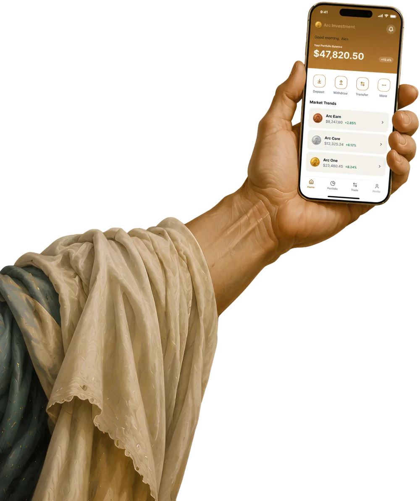

<div align="center">


### Pay anyone. Pay anywhere.

**Cross-border payments infrastructure for individuals and businesses.**

Receive international payments and pay global teams using stablecoins and local banking rails.

<p>
  <a href="https://payzoll.finance">Website</a> ·
  <a href="https://drive.google.com/drive/folders/1rufix48N-JZp3jfq2B0VqnaVI_A981nL?usp=sharing">Demo</a> ·
  <a href="https://x.com/PayZoll">X</a> ·
  <a href="https://www.linkedin.com/company/payzoll">LinkedIn</a> ·
  <a href="https://dune.com/eren07/payzoll">Dune Analytics</a>
</p>


</div>

---

## Global payments, without the usual friction

Cross-border payments can mean fragmented providers, opaque exchange-rate markups, manual reconciliation, and difficulty collecting the right supporting records.

**PayZoll brings supported fiat and stablecoin payment flows into one platform.** Individuals can receive international income, while businesses can pay employees, contractors, and vendors across supported countries.

<div align="center">
  
</div>

## The PayZoll platform

<table>
  <tr>
    <td width="50%" valign="top">
      
      <h3>Individual Account</h3>
      For freelancers, remote workers, consultants, and independent professionals receiving payments from international clients.
      <ul>
        <li>Receive supported stablecoins such as USDC and USDT.</li>
        <li>Receive supported fiat currencies through available virtual bank account details.</li>
        <li>Initiate eligible conversions and withdrawals to a supported local bank account.</li>
        <li>Access transaction records and applicable remittance documentation.</li>
      </ul>
    </td>
    <td width="50%" valign="top">
      
      <h3>Business Account</h3>
      For companies managing overseas collections and payments to employees, contractors, and vendors.
      <ul>
        <li>Fund eligible payment flows using supported fiat currencies or stablecoins.</li>
        <li>Organize one-off and bulk payouts.</li>
        <li>Manage global payroll workflows where available.</li>
        <li>Keep transaction activity and supporting records together.</li>
      </ul>
    </td>
  </tr>
</table>

## How it works

<div align="center">
  
</div>

### For individuals

1. **Receive:** A client pays using a supported stablecoin or fiat payment method.
2. **Review:** The funds arrive through the applicable wallet or banking rail.
3. **Withdraw or convert:** Choose an available payout option and review the quote and fees.
4. **Settle:** The payment is routed through the relevant partners and supported rails.
5. **Access records:** Review transaction details and download applicable documentation when available.

### For businesses

1. **Fund:** Add funds using an available stablecoin or fiat funding method.
2. **Create a payout:** Set up a one-off payment or organize a payroll or bulk payout run.
3. **Add recipients:** Provide recipient and destination-bank details required for the payout.
4. **Review and submit:** Check amounts, currencies, fees, and the applicable quote.
5. **Track:** Follow transaction status and access available records for reconciliation.

## One platform. Two payment rails.

PayZoll uses a dual-rail approach to connect supported stablecoin and fiat payment flows.

<div align="center">
  
</div>

```text
                 PAYZOLL
                    |
         +----------+----------+
         |                     |
   Stablecoin rails        Fiat rails
    USDC / USDT        Supported currencies
         |                     |
         +----------+----------+
                    |
          Payment routing and
        conversion where applicable
                    |
          Recipient's bank account
                    |
       Transaction records and
        applicable documentation
```

- **Stablecoin rails:** Support eligible payment flows funded or received using supported stablecoins.
- **Fiat rails:** Connect supported currencies with available banking and payment partners.
- **Payment records:** Help users keep track of transaction details and retrieve applicable documentation.

Available routes depend on the transaction, account, currency, destination, partner capabilities, and applicable requirements.

## Global reach

<div align="center">
  <table>
    <tr>
      <td align="center" width="33%">
        <h2>50+</h2>
        Supported fiat currencies
      </td>
      <td align="center" width="33%">
        <h2>80+</h2>
        Countries supported
      </td>
      <td align="center" width="33%">
        <h2>USDC / USDT</h2>
        Supported stablecoins
      </td>
    </tr>
  </table>
</div>

Current availability varies by account type, corridor, currency, payment method, and partner. Check the live product for the latest supported options.

## Transparent pricing

<div align="center">
  
</div>

PayZoll's published pricing has included a **1% flat fee with zero additional FX markup**, using a mid-market reference rate. Review the live quote and applicable terms before confirming a transaction, as pricing and availability may vary by corridor or transaction type.

## Remittance documentation and tax support

<div align="center">
  
</div>

International payments may require identity or business verification, source-of-funds information, payment-purpose details, screening, and supporting documents.

PayZoll helps users organize transaction records and access applicable documentation through the platform. For eligible inward remittances to India, this may include Foreign Inward Remittance Advice (FIRA) or other documents made available through the relevant banking and payment partners.

<div align="center">
  
</div>

**Please note:**
- Documentation depends on the transaction, corridor, partner, and applicable rules.
- A transaction receipt or remittance intimation is not necessarily the same as a bank-issued remittance certificate.
- Not every transaction qualifies for every document.
- Tax and compliance requirements differ by jurisdiction. Users should seek qualified advice for their circumstances.

## Built for

- **Freelancers and contractors** receiving income from overseas clients.
- **Remote teams** receiving eligible international payments.
- **Exporters and service businesses** collecting cross-border payments.
- **Startups and companies** paying international teams and vendors.
- **Finance and HR teams** managing payouts and transaction reconciliation.

## Product links

| Resource | Link |
| --- | --- |
| Website | [payzoll.finance](https://payzoll.finance) |
| Demo video and materials | [Open demo folder](https://drive.google.com/drive/folders/1rufix48N-JZp3jfq2B0VqnaVI_A981nL?usp=sharing) |
| X | [@PayZoll](https://x.com/PayZoll) |
| LinkedIn | [PayZoll](https://www.linkedin.com/company/payzoll) |
| Dune Analytics | [PayZoll dashboard](https://dune.com/eren07/payzoll) |

## About this repository

This is the PayZoll web frontend, built with React 19, TypeScript, Vite and Tailwind CSS.

```bash
npm install
cp .env.example .env   # then fill in the API URLs below
npm run dev            # start the dev server
npm run build          # type-check and build to dist/
npm run lint
```

| Variable | Purpose |
| --- | --- |
| `VITE_AUTH_API_URL` | Auth service |
| `VITE_GATEWAY_API_URL` | API gateway |
| `VITE_AGENT_CHAT_API_URL` | Agent chat API |
| `VITE_AGENT_MANAGEMENT_API_URL` | Agent management API |

The `Dockerfile`, `nginx.conf.template` and `cloudbuild.yaml` files handle container builds and deployment.

## Disclaimer

PayZoll provides technology and payment workflows through its platform and relevant third-party partners. Banking services, payment routes, conversions, documentation, and settlement times depend on partner availability, verification, corridor support, and applicable law. Nothing in this README constitutes legal, tax, investment, or financial advice or guarantees a specific settlement time, regulatory outcome, or document issuance.

---

<div align="center">


### PayZoll
**People. Payments. Progress. Globally.**

[Website](https://payzoll.finance) · [X](https://x.com/PayZoll) · [LinkedIn](https://www.linkedin.com/company/payzoll)

</div>
